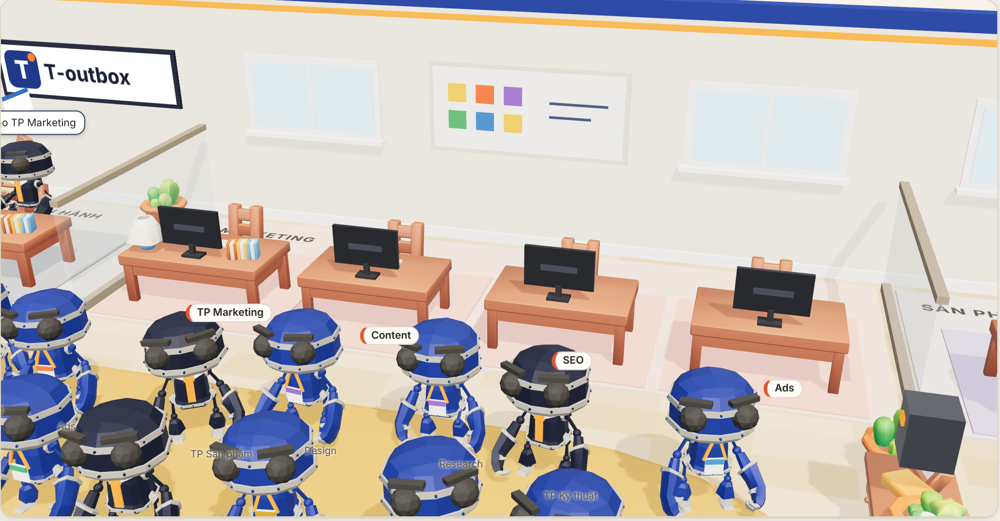

# T-outbox

Biến Claude Code thành một công ty. Bạn là sếp, Claude là CEO, các subagent là trưởng phòng và nhân viên. Một văn phòng 3D chạy trên máy bạn cho thấy đội robot AI đi lại, ngồi bàn, giao việc cho nhau theo thời gian thực, và tất cả mặc đồng phục theo brand bạn nạp vào.




Ảnh trên là chế độ diễn thử, nội dung công việc trong ảnh là ví dụ minh họa.

## Cơ cấu công ty

CEO là phiên Claude Code chính. CEO giao việc cho trưởng phòng, trưởng phòng chia tiếp cho nhân viên trong phòng; việc gọn của một chuyên môn thì CEO giao thẳng cho nhân viên.

| Phòng | Trưởng phòng | Nhân viên |
| --- | --- | --- |
| Marketing | `marketing-lead` | `content-writer`, `seo-specialist`, `ads-specialist` |
| Sản phẩm & Thiết kế | `product-manager` | `designer`, `researcher` |
| Kỹ thuật & Dữ liệu | `tech-lead` | `web-developer`, `data-analyst`, `qa-reviewer` |
| Kinh doanh & CSKH | `sales-lead` | `customer-support` |
| Vận hành | `operations-lead` | `finance-analyst`, `legal-counsel`, `hr-specialist` |

Khi gọi đích danh, thêm tiền tố plugin: `t-outbox:content-writer`.

Đây là cơ cấu của một doanh nghiệp điển hình, không phải bản sao sơ đồ tổ chức của công ty nào. Mọi nhân viên theo chung nguyên tắc: không bịa số liệu, số liệu phải có nguồn, tách rõ dữ liệu đã kiểm chứng, ước tính và nhận định. Sản phẩm được lưu vào `deliverables/<phòng>/` trong dự án của bạn. Chuyên viên tài chính và pháp chế luôn ghi rõ sản phẩm của họ là bản tham khảo, cần người có chứng chỉ hành nghề xác nhận.

## Yêu cầu

- Claude Code (đã thử với bản 2.1.322)
- Node.js 18 trở lên
- Trình duyệt có WebGL cho bản 3D; không có thì trang tự chuyển sang sơ đồ 2D

## Cài đặt

Trong Claude Code, thêm repo này làm marketplace rồi cài plugin (thay `<owner>/<repo>` bằng địa chỉ GitHub của repo):

```
/plugin marketplace add <owner>/<repo>
/plugin install t-outbox@t-outbox
```

Hoặc dùng thử ngay từ bản clone, không cần cài:

```bash
claude --plugin-dir /đường/dẫn/tới/t-outbox
```

## Cách dùng

| Lệnh | Việc nó làm |
| --- | --- |
| `/t-outbox:open` | Mở văn phòng (mặc định `http://127.0.0.1:4747`) |
| `/t-outbox:brief <yêu cầu>` | Giao một đầu việc lớn: CEO chia theo phòng ban, giao người, cho QA soát, rồi báo cáo |
| `/t-outbox:brand <nguồn brand>` | Nạp tên, logo chữ và màu thương hiệu để đổi đồng phục và văn phòng |
| `/t-outbox:hire <vai trò>` | Tuyển thêm nhân viên mới cho dự án |

Ví dụ:

```
/t-outbox:brief Ra mắt khóa học mới trong 30 ngày, ngân sách 50 triệu: cần kế hoạch marketing, landing page và dự toán
```

Việc nhỏ thì cứ nói bình thường. Khi plugin bật, mỗi phiên được nhắc ngắn gọn rằng Claude đang là CEO và nên giao việc chuyên môn cho đúng phòng; việc nhỏ Claude vẫn tự làm.

### Xem thử không cần Claude

```bash
node scripts/server.js --project /tmp/t-outbox-demo --open
```

Khi chưa có việc thật trong 10 phút gần nhất, văn phòng tự diễn một buổi làm việc mẫu và ghi rõ "Demo" ở góc trên. Ngay khi Claude Code bắt đầu làm việc, văn phòng chuyển sang việc thật.

## Văn phòng cho thấy gì

| Trong văn phòng | Claude Code đang |
| --- | --- |
| CEO ngồi bàn, bong bóng ghi việc đang làm | Nhận yêu cầu, đọc, viết, chạy lệnh |
| Tờ giấy bay từ người giao tới bàn người nhận | Gọi một subagent |
| Robot rời pantry đi về bàn, ngồi gõ phím, màn hình sáng màu phòng ban | Subagent đang chạy |
| Robot vẫy tay, mặt ngạc nhiên, dấu chấm than đỏ trên đầu | Chờ bạn cấp quyền cho một công cụ |
| Giơ ngón cái hoặc nhảy múa, kèm pháo giấy | Subagent xong việc, hoặc CEO xong một lượt |
| Biển "Đang tuyển" trên bàn | Vị trí đang để trống |

Các nút phía trên văn phòng:

- **Tùy biến:** đổi tên công ty, khẩu hiệu, logo chữ, ba màu brand, kiểu đồng phục, tên từng nhân viên, đánh dấu vị trí đang tuyển. Lưu xong văn phòng đổi ngay.
- **Sôi nổi** (mặc định bật): việc CEO tự làm cũng được một nhân viên đúng chuyên môn hỗ trợ, để cả văn phòng chuyển động. Tìm trên web thì Research hỗ trợ, viết file `.md` thì Content, viết mã thì Web, file số liệu thì Data. Tắt đi thì chỉ CEO và subagent thật chuyển động.
- **Theo việc** (mặc định bật): máy quay tự lướt tới gần người vừa nhận việc, xong lượt thì lùi về toàn cảnh. Kéo chuột là máy quay trả quyền điều khiển cho bạn.
- **Ẩn chi tiết:** ẩn tên file, câu tìm kiếm và nội dung việc trong bong bóng, bảng việc và nhật ký, dùng khi quay màn hình.
- **Buổi tối:** đổi ánh sáng ngày và tối.
- **Góc nhìn mặc định, Xem 2D:** kéo chuột để xoay, lăn chuột để phóng; phóng gần sẽ hiện tên người đang đứng ở pantry. Bấm tên một phòng trong danh sách **Phòng ban** để lướt tới phòng đó.

Bên dưới là **bảng công việc** ba cột (chờ nhận, đang làm, đã xong). Mỗi thẻ ghi người làm, phòng ban, người giao, đồng hồ chạy và việc đang làm lúc này; bấm vào thẻ để xem từng bước. Khi nhiều phiên Claude Code cùng làm trong một dự án, mỗi phiên có một màu riêng trên thẻ và trên tờ giấy giao việc.

## Đồng phục theo brand

Thân robot sơn màu chính của brand, đeo dây thẻ màu nhấn, thẻ nhân viên mang vạch màu phòng ban. Trưởng phòng và CEO sơn màu phụ (như áo khoác), có cổ áo trắng và cà vạt màu nhấn. Tường văn phòng có biển tên công ty và viền màu brand; thảm pantry pha màu brand.

Cách nạp brand:

1. `/t-outbox:brand` kèm nguồn, ví dụ `/t-outbox:brand theo brand guideline trong docs/brand.md`. Claude đọc guideline và ghi `.t-outbox/brand.json`.
2. Hoặc bấm **Tùy biến** trong văn phòng.
3. Hoặc tự sửa `.t-outbox/brand.json`:

```json
{
  "name": "Tên công ty",
  "tagline": "Khẩu hiệu ngắn",
  "logoText": "T",
  "colors": { "primary": "#1f3a8a", "secondary": "#1b2238", "accent": "#ff8a1f" },
  "uniform": { "style": "polo" }
}
```

`uniform.style` (`polo`, `shirt`, `tshirt`) hiện chỉ áp dụng cho bản 2D và để dành cho nhân vật người. Màu mặc định của T-outbox là màu tạm do repo đặt, bạn nên thay bằng brand của mình.

## Tùy biến nhân sự

Tạo `.t-outbox/roster.json` trong dự án và ghi đè theo `id`, hoặc thêm người mới:

```json
{
  "staff": [
    { "id": "content-writer", "name": "Mai" },
    { "id": "seo-specialist", "off": true },
    { "id": "designer", "match": ["*creative*", "kf-design-*"] },
    { "id": "video-editor", "name": "Video", "title": "Dựng video", "dept": "marketing" }
  ]
}
```

- `match`: các subagent bạn đã có sẵn, tên khớp mẫu, sẽ ngồi vào bàn của người này. Subagent không khớp ai thì ngồi khu cộng tác viên.
- `off: true`: vị trí để trống, bàn hiện biển "Đang tuyển".
- Người mới không có tọa độ bàn thì ngồi khu cộng tác viên.

Hồ sơ từng nhân viên là một file tiếng Việt trong `agents/`; sửa trực tiếp để đổi cách làm việc. Sơ đồ phòng, tọa độ bàn và phòng ban nằm trong `office/roster.json`.

## Cách hoạt động

```
Claude Code ── hooks ──> scripts/record-event.js ──> <dự án>/.t-outbox/events.jsonl
                                                              │
                              trình duyệt <── SSE ── scripts/server.js
```

Hook lắng nghe `SessionStart`, `UserPromptSubmit`, `PreToolUse`, `PermissionRequest`, `SubagentStart`, `SubagentStop`, `Stop`, `SessionEnd` và ghi mỗi sự kiện thành một dòng JSON. Server đẩy phần mới của file sang trình duyệt; trạng thái văn phòng được dựng lại từ file này nên tải lại trang không mất gì.

Văn phòng 3D dựng bằng [three.js](https://threejs.org) (giấy phép MIT, đã kèm trong `dashboard/vendor/` để chạy offline).

### Mô hình 3D và ghi công

| Mô hình | Tác giả | Giấy phép | Vị trí |
| --- | --- | --- | --- |
| RobotExpressive (robot có 14 hoạt ảnh và 3 biểu cảm) | Tomás Laulhé, chỉnh sửa bởi Don McCurdy; lấy từ kho ví dụ của three.js | CC0 1.0 | `dashboard/assets/robot.glb` |
| KayKit Furniture Bits 1.0 (bàn, ghế, sofa, thảm, đèn, tủ, cây) | Kay Lousberg | CC0 1.0 | `dashboard/assets/furniture/` |

Tường, sàn, màn hình, biển hiệu và phụ kiện đồng phục dựng bằng hình khối trong mã nguồn.

Nhân viên hiện là robot vì đây là bộ nhân vật có khung xương, hoạt ảnh và giấy phép CC0 đã xác minh được. Muốn đổi sang nhân vật người, cần một bộ mô hình `.glb` có hoạt ảnh đi, ngồi, đứng yên (ví dụ Kenney Mini Characters, CC0) rồi sửa phần nạp mô hình trong `dashboard/view3d.js`.

## Dữ liệu và quyền riêng tư

- Mọi thứ nằm trên máy bạn. Server chỉ nghe ở `127.0.0.1`, không gửi dữ liệu đi đâu và trang không tải gì từ mạng.
- Server chỉ ghi vào `.t-outbox/brand.json` và `.t-outbox/roster.json`, khi bạn bấm Lưu trong bảng Tùy biến. Yêu cầu ghi từ trang web khác bị từ chối.
- File sự kiện lưu: 280 ký tự đầu của lời bạn giao việc và của câu trả lời cuối, mô tả ngắn của việc được giao, tên công cụ, đường dẫn file, câu truy vấn tìm kiếm, tên miền trang được mở. Nó không lưu nội dung file hay câu lệnh shell.
- `events.jsonl` tự được loại khỏi git và tự xoay vòng khi vượt 5 MB.
- Tắt ghi sự kiện tạm thời bằng biến môi trường `T_OUTBOX_DISABLED=1`.

## Giới hạn hiện tại

- Trưởng phòng chỉ giao tiếp được cho nhân viên khi Claude Code cho phép subagent gọi subagent. Nếu môi trường đặt `CLAUDE_CODE_MAX_SUBAGENT_SPAWN_DEPTH=1`, trưởng phòng sẽ tự làm phần việc đó và ghi rõ trong báo cáo.
- Dấu chờ duyệt quyền chỉ tắt khi nhân viên đó có hoạt động kế tiếp, nên có thể còn hiện một lúc sau khi bạn đã duyệt.
- Phiên bị tắt đột ngột: nhân viên của phiên đó ở lại bàn tối đa 30 phút rồi mới về pantry.
- Nhân vật là robot, chưa có nhân vật người.
- Chưa có chụp ảnh, quay clip và tour trong trang; danh sách việc riêng của Claude (TodoWrite) chưa hiện thành thẻ.
- Design chỉ dựng được bản thiết kế thật khi phiên làm việc có công cụ thiết kế kết nối (ví dụ Canva qua MCP); nếu không, kết quả là brief hoặc file SVG/HTML.

## Giấy phép

Mã nguồn: MIT, xem [LICENSE](LICENSE). three.js giữ giấy phép riêng tại `dashboard/vendor/LICENSE-three.txt`. Mô hình 3D: CC0, xem bảng ghi công ở trên và `dashboard/assets/furniture/LICENSE.txt`.
