# T-outbox

Biến Claude Code thành một tập đoàn. Bạn là sếp, Claude là CEO, các subagent là trưởng phòng và nhân viên. Trụ sở là một tòa tháp 3D chạy trên máy bạn: mỗi phòng ban một tầng, nhân viên đi lại, ngồi bàn, giao việc cho nhau theo thời gian thực, và tất cả mặc đồng phục theo brand bạn nạp vào.

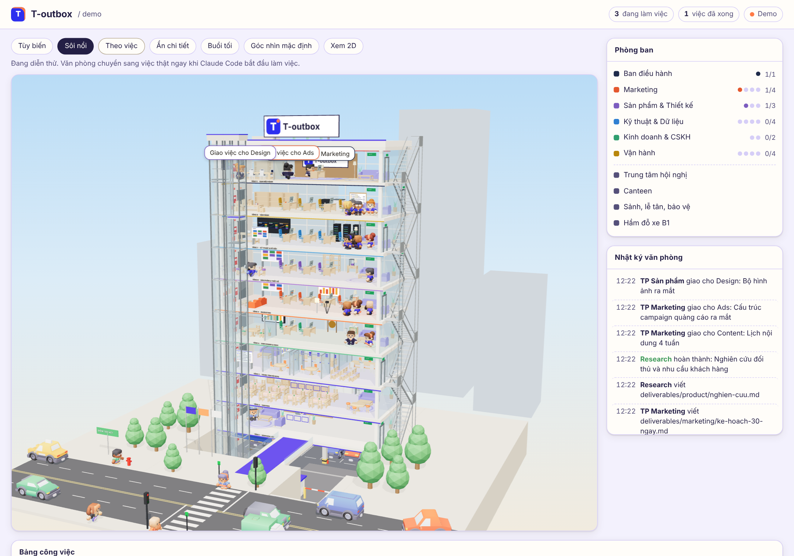

| Tầng phòng ban | Trung tâm hội nghị |
| --- | --- |
| 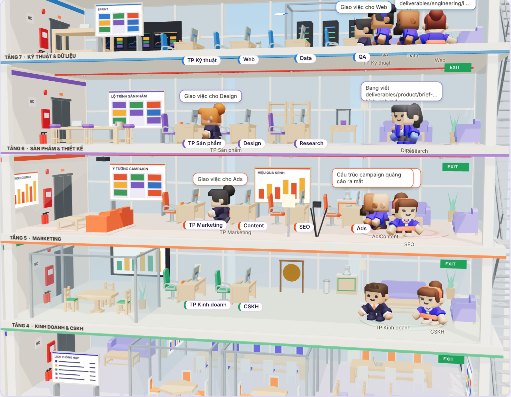 | 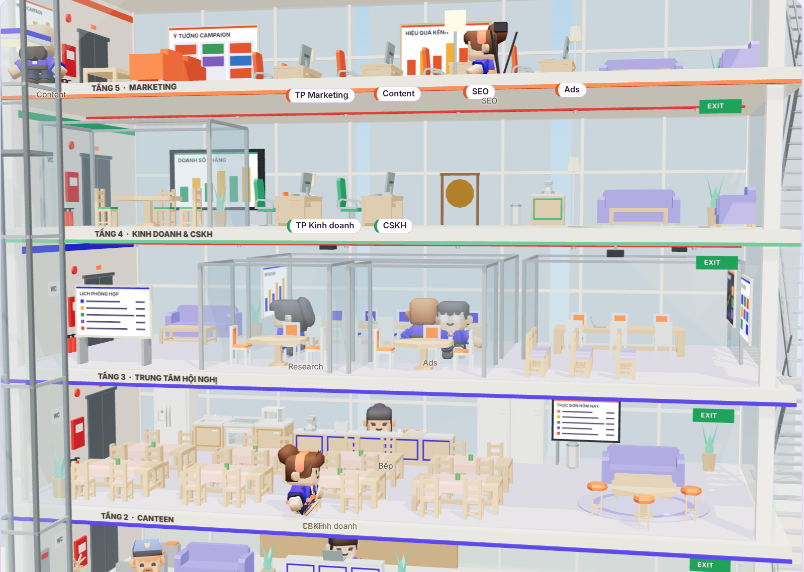 |

| Hai thang máy | Nhân viên lái xe ra khỏi hầm |
| --- | --- |
| 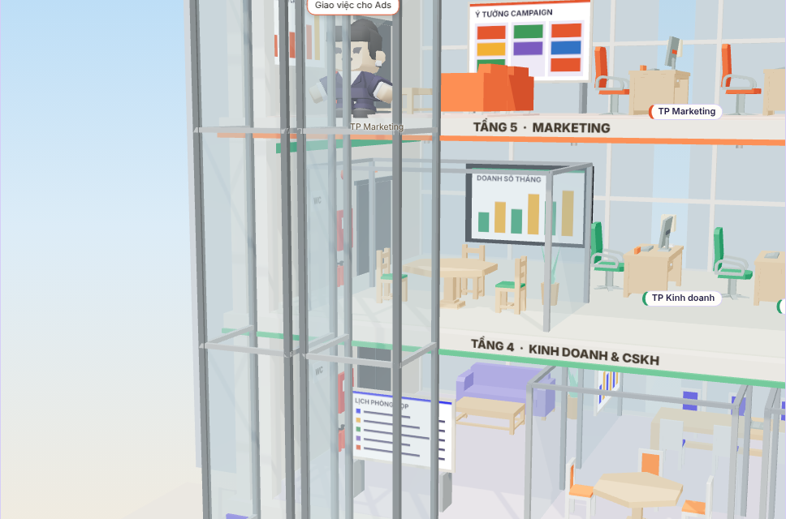 | 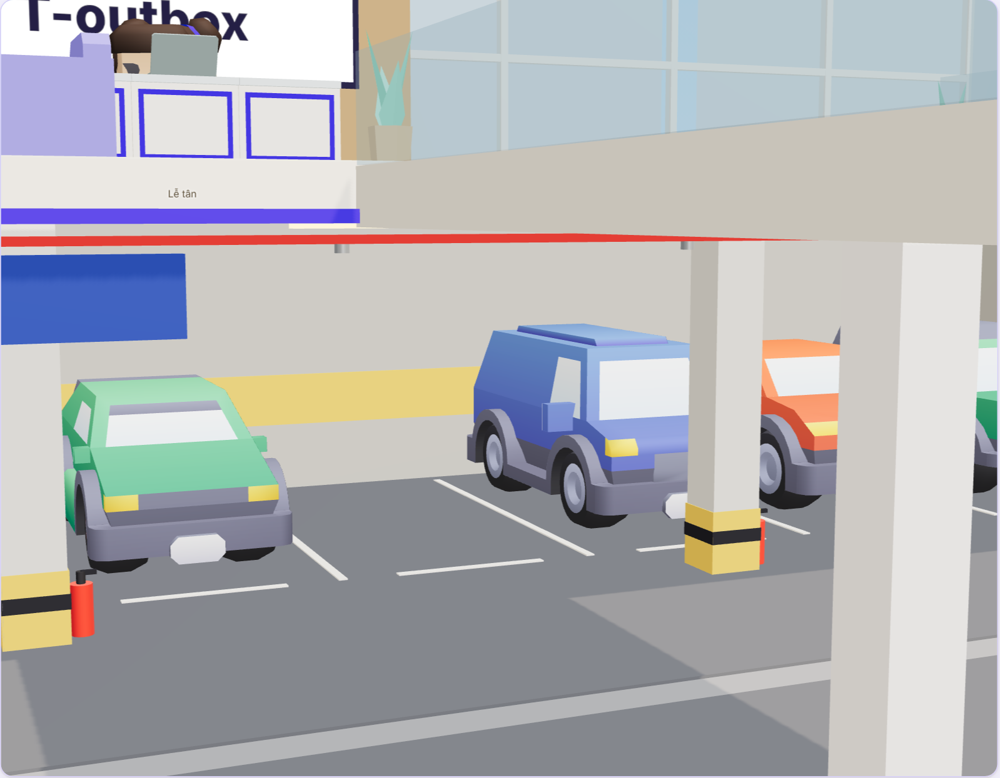 |

| Họp nhóm ở phòng họp vừa | CEO họp với các trưởng phòng |
| --- | --- |
| 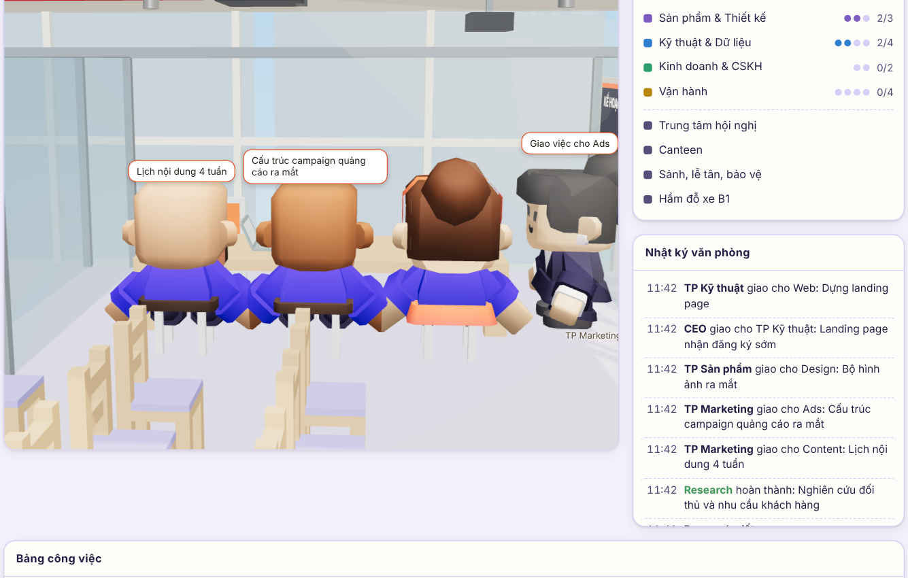 | 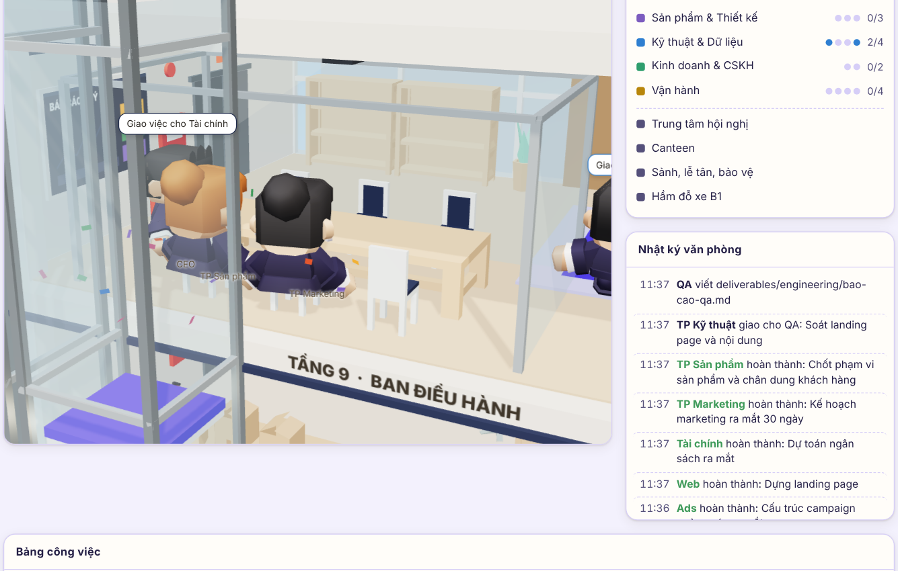 |

| Đi thang bộ | Người qua đường khi đèn đỏ cho xe |
| --- | --- |
| 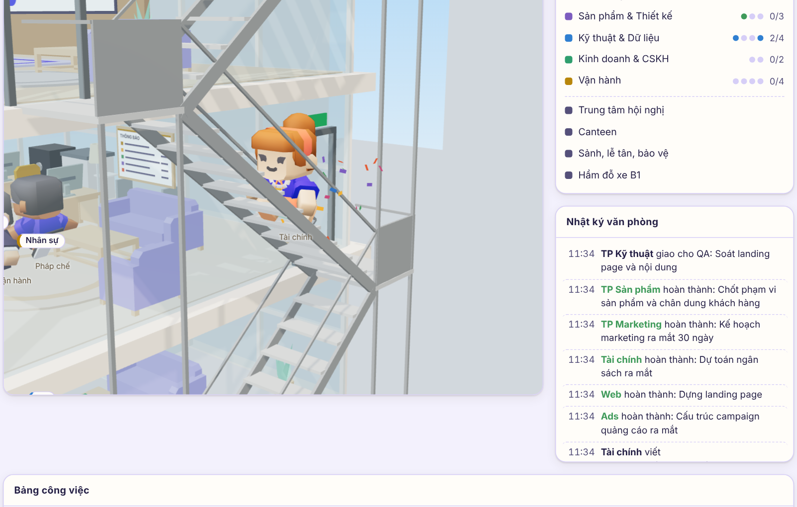 | 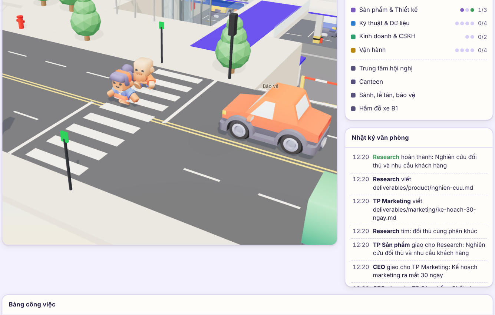 |

| Xe dừng nhường đường trước khi vào làn | |
| --- | --- |
| 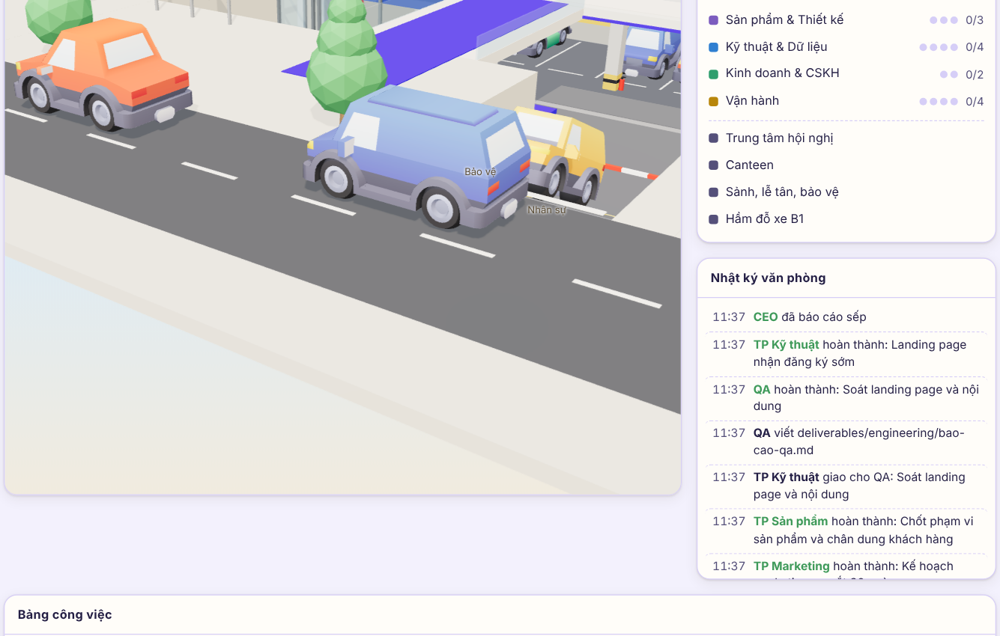 | |

| Canteen | Sảnh, lễ tân, bảo vệ |
| --- | --- |
| 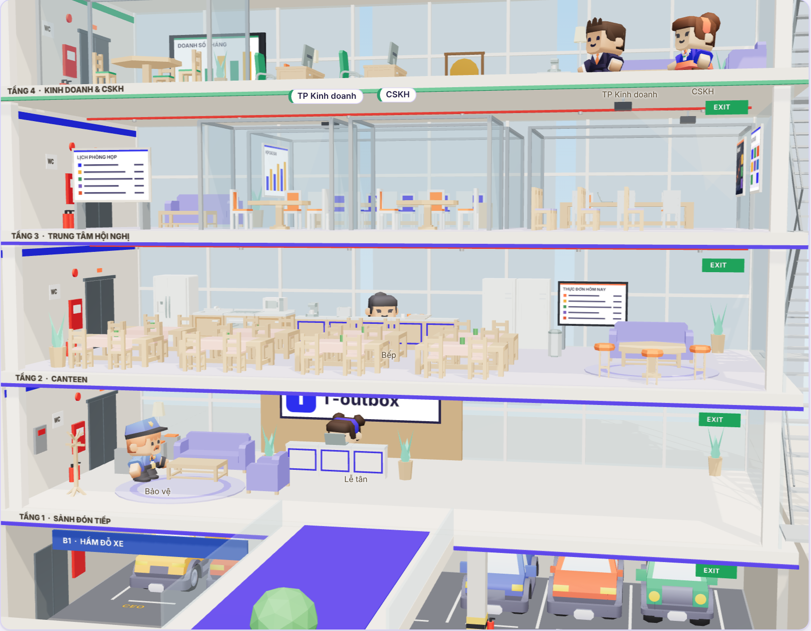 | 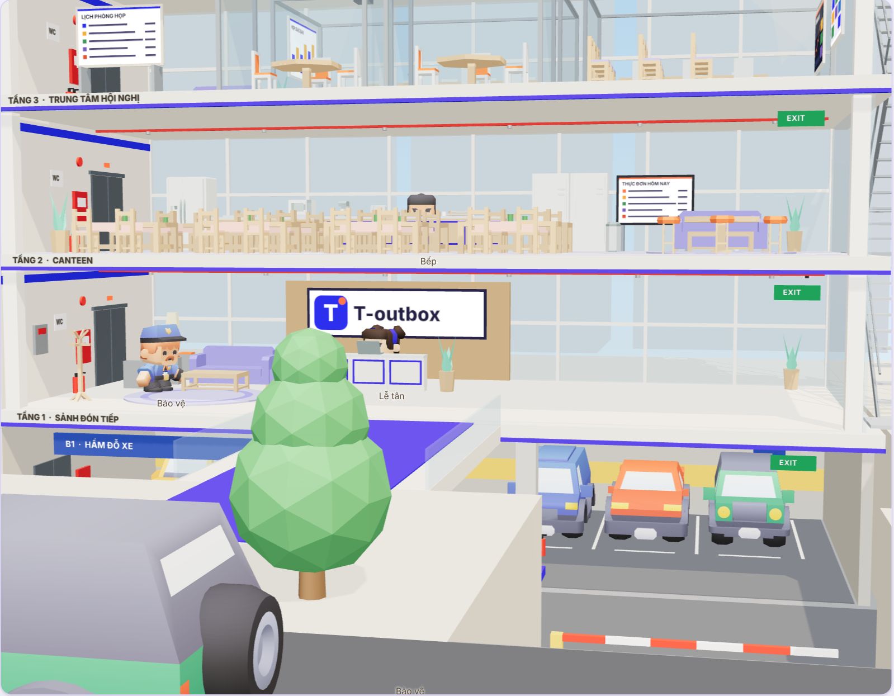 |

Ảnh chụp ở chế độ diễn thử, nội dung công việc trong ảnh là ví dụ minh họa.

## Cơ cấu công ty

CEO là phiên Claude Code chính. CEO giao việc cho trưởng phòng, trưởng phòng chia tiếp cho nhân viên trong phòng; việc gọn của một chuyên môn thì CEO giao thẳng cho nhân viên.

| Phòng | Trưởng phòng | Nhân viên |
| --- | --- | --- |
| Marketing | `marketing-lead` | `content-writer`, `seo-specialist`, `ads-specialist` |
| Sản phẩm & Thiết kế | `product-manager` | `designer`, `researcher` |
| Kỹ thuật & Dữ liệu | `tech-lead` | `web-developer`, `data-analyst`, `qa-reviewer` |
| Kinh doanh & CSKH | `sales-lead` | `customer-support` |
| Vận hành | `operations-lead` | `finance-analyst`, `legal-counsel`, `hr-specialist` |

Khi gọi đích danh, thêm tiền tố plugin: `t-outbox:content-writer`.

## Tòa nhà

Các tầng xếp theo logic của một trụ sở thật, từ khu công cộng lên khu riêng tư:

| Tầng | Công năng | Bố trí |
| --- | --- | --- |
| B1 | Hầm đỗ xe | Ô đỗ có vạch, xe đậu, chốt bảo vệ, barie, ram dốc lên đường |
| 1 | Sảnh đón tiếp | Quầy lễ tân, tường thương hiệu, khu chờ, cổng kiểm soát, bảo vệ, tủ báo cháy trung tâm; bàn cho cộng tác viên |
| 2 | Canteen | Bếp, quầy phục vụ, tủ mát, bảng thực đơn, hai dãy bàn ăn, góc cà phê |
| 3 | Trung tâm hội nghị | Sảnh chờ có bảng lịch phòng, phòng họp lớn 10 chỗ và phòng vừa 6 chỗ có máy chiếu, hai phòng họp nhỏ, khu đào tạo |
| 4 | Kinh doanh & CSKH | Bảng doanh số, cồng mừng chốt đơn, phòng tiếp khách vách kính |
| 5 | Marketing | Bảng ý tưởng, bảng hiệu quả kênh, góc brainstorm có máy chiếu, góc chụp hình |
| 6 | Sản phẩm & Thiết kế | Bảng lộ trình, kệ mẫu, bàn phác thảo lớn, máy in 3D |
| 7 | Kỹ thuật & Dữ liệu | Tường màn hình giám sát, phòng máy chủ vách kính, bàn đứng |
| 8 | Vận hành | Dãy tủ hồ sơ, két sắt, máy photocopy, bảng thông báo, bàn lưu trữ |
| 9 | Ban điều hành | Bàn CEO, phòng họp hội đồng có máy chiếu, tủ sách, khu tiếp khách |
| Mái | | Biển tên công ty, sân đỗ trực thăng, buồng máy thang |

Hạ tầng chung của tòa nhà:

- **Hai thang máy kính** trước mặt tiền bên trái, chạy từ hầm B1 lên tầng cao nhất. Hai thang chia nhau lượt gọi: mỗi thang tới tầng có người chờ mà thang kia chưa nhận, chở tối đa 4 người, trả ở tầng gần nhất trước.
- **Thang bộ thoát hiểm** bằng thép ở hông phải, chạy suốt chiều cao tòa nhà; mỗi tầng có cửa ra thang ngay chiếu nghỉ.
- **Phòng cháy chữa cháy** ở mọi tầng: tủ vòi và bình chữa cháy cạnh thang máy, chuông báo, đường ống sprinkler dưới trần, biển EXIT; ngoài sân có trụ nước và biển điểm tập kết.
- **An ninh:** bảo vệ ở sảnh và ở chốt hầm xe, camera ở sảnh và hầm, cổng kiểm soát trước thang máy.
- **Khuôn viên:** quảng trường, cầu dẫn trải thảm vào sảnh, cột cờ, cây, đường phố bốn làn có đèn giao thông và vạch qua đường trước cầu dẫn, vạch dừng ở đầu ram, người đi đường trên vỉa hè.
- Mỗi tầng có biển WC cạnh lõi thang.

### Nhân viên dùng tòa nhà như thế nào

| Tình huống | Nhân viên làm gì |
| --- | --- |
| CEO giao việc cho từ hai trưởng phòng trở lên liền nhau | CEO đi sang phòng họp hội đồng ở tầng 9 đứng trình bày; các trưởng phòng lên ngồi họp, họp xong về bàn |
| CEO giao việc cho một người | Người nhận lên tầng 9, đứng trước bàn CEO nhận việc rồi về bàn mình |
| Trưởng phòng chia việc cho người trong phòng | Trưởng phòng và người nhận lên trung tâm hội nghị. Giao cho một người thì vào phòng họp nhỏ; hai tới sáu người thì vào phòng họp vừa, trưởng phòng đứng trình bày; đông hơn thì vào phòng họp lớn. Phòng đang có người họp thì chọn phòng khác; hết phòng thì giao như bình thường |
| Người ở tầng khác giao việc trong các trường hợp còn lại | Người nhận tới bàn người giao nhận việc |
| Được giao việc cùng tầng trong các trường hợp còn lại | Tờ giấy giao việc bay từ người giao sang bàn người nhận |
| Đang rảnh | Đứng ở góc tiếp khách của tầng; thỉnh thoảng xuống canteen, lên khu đào tạo ngồi nghe, hoặc lấy xe ra ngoài |
| Đang ở canteen hay khu đào tạo thì có việc | Bỏ dở giờ nghỉ, về bàn |
| Đang lái xe ở ngoài thì có việc | Quay xe về ngay, đỗ xe rồi lên bàn; bong bóng việc đi theo xe |

**Đi lại giữa các tầng.** Cách một tầng thì đi thang bộ: ra cửa thang ở vách phải, leo từng vế thang, vào tầng đích. Cách hai tầng mà thang máy đang có từ ba lượt gọi trở lên cũng đi thang bộ. Xa hơn, hoặc xuống hầm B1 (thang bộ không xuống hầm), thì đi thang máy.

**Họp.** Các lần giao việc của cùng một người trong vòng 1,2 giây được gom thành một cuộc họp. Cuộc họp chỉ bắt đầu khi đủ người (hoặc sau 30 giây nếu có người tới muộn) và kéo dài 3,5 giây cộng 1 giây cho mỗi người dự. Ai làm xong việc trước khi buổi họp bắt đầu thì bỏ họp, về luôn; nếu không còn ai dự thì người chủ trì cũng rời phòng. Ai làm xong việc trước khi kịp ngồi vào bàn thì không đi về bàn nữa mà về chỗ chờ, để nhân vật không hiện trạng thái cũ. Người đang có việc đi nhanh hơn người đang rảnh. Người vào chỗ theo lối riêng của từng phòng: hàng ghế sau đi vòng đầu bàn, phòng họp nhỏ đi qua cửa ở vách sau, khu đào tạo đi theo khe giữa hai hàng ghế.

**Tránh nhau.** Người đi ngược chiều cùng nép sang phải để đi qua nhau, trên hành lang lẫn trên thang bộ. Người phía trước đi cùng chiều mà chậm thì người sau giảm tốc theo, sát quá thì dừng. Hai người đi cắt ngang nhau (ví dụ gặp nhau ở góc hành lang) thì người thấy đối phương ở bên phải dừng nhường, người kia đi tiếp. Người chờ thang máy đứng xếp hàng trước cửa cabin; tới tầng thì bước ra lần lượt. Họp xong mọi người rời phòng lần lượt. Người đi đường cũng đi bên phải: mỗi chiều trên vỉa hè và trên vạch qua đường có lối riêng, chờ đèn thì xếp hàng theo thứ tự đến.

**Giao thông.** Đường bốn làn, mỗi chiều hai làn, xe chạy bên phải. Mỗi xe giữ khoảng cách với xe phía trước. Xe bị xe chậm chặn thì sang làn vượt khi làn đó đủ trống, vượt xong về lại làn phải; không chuyển làn trong đoạn 7 m quanh vạch qua đường. Đèn giao thông đổi xanh, vàng, đỏ; xe dừng sau vạch dừng khi đèn đỏ, đèn vàng mà còn đủ xa thì dừng, đã sát vạch thì đi tiếp. Người đi bộ chỉ bước xuống khi đèn xe đã đỏ được 1,5 giây và còn đủ thời gian đi hết vạch. Xe xếp hàng chờ đèn không dừng chắn lối ra vào hầm. Xe ra khỏi hầm dừng trước barie chờ barie nâng, lên ram, dừng ở vạch nhường đường tới khi làn trống rồi mới rẽ phải vào làn. Xe về giảm tốc rẽ phải vào ram, dừng chờ barie, chạy qua ô của mình rồi lùi vào ô.

Khi khung hình kéo dài (máy chậm), phần mô phỏng được chia thành các bước nhỏ tối đa 0,04 giây để người không đi xuyên qua nhau và xe không chạy xuyên qua nhau.

Nhân viên đi theo hành lang và sảnh thang của từng tầng nên không xuyên qua bàn ghế hay phòng kính. Việc đi lại chỉ là phần trình diễn: bong bóng, bảng công việc và nhật ký vẫn phản ánh ngay trạng thái thật của subagent, kể cả khi nhân vật còn đang trên đường về bàn.

Lễ tân, bảo vệ và bếp là người của tòa nhà, không phải subagent: họ đứng trực và không nhận việc. Thứ tự tầng nằm trong `office/roster.json`; nội thất từng tầng nằm trong các hàm `furnish_*` của `dashboard/view3d.js`.

## Yêu cầu

- Claude Code (đã thử với bản 2.1.322)
- Node.js 18 trở lên
- Trình duyệt có WebGL cho bản 3D; không có thì trang tự chuyển sang sơ đồ 2D

## Cài đặt

Trong Claude Code, thêm repo này làm marketplace rồi cài plugin:

```
/plugin marketplace add thecoolestmarperindawurl/t-outbox-office
/plugin install t-outbox@t-outbox
```

Hoặc dùng thử ngay từ bản clone, không cần cài:

```bash
claude --plugin-dir /đường/dẫn/tới/t-outbox
```

## Cách dùng

| Lệnh | Việc nó làm |
| --- | --- |
| `/t-outbox:open` | Mở trụ sở (mặc định `http://127.0.0.1:4747`) |
| `/t-outbox:brief <yêu cầu>` | Giao một đầu việc lớn: CEO chia theo phòng ban, giao người, cho QA soát, rồi báo cáo |
| `/t-outbox:brand <nguồn brand>` | Nạp tên, logo chữ và màu thương hiệu để đổi đồng phục và văn phòng |
| `/t-outbox:hire <vai trò>` | Tuyển thêm nhân viên mới cho dự án |

Ví dụ:

```
/t-outbox:brief Ra mắt khóa học mới trong 30 ngày, ngân sách 50 triệu: cần kế hoạch marketing, landing page và dự toán
```

Việc nhỏ thì cứ nói bình thường. Khi plugin bật, mỗi phiên được nhắc ngắn gọn rằng Claude đang là CEO và nên giao việc chuyên môn cho đúng phòng; việc nhỏ Claude vẫn tự làm.

### Xem thử không cần Claude

```bash
node scripts/server.js --project /tmp/t-outbox-demo --open
```

Khi chưa có việc thật trong 10 phút gần nhất, văn phòng tự diễn một buổi làm việc mẫu và ghi rõ "Demo" ở góc trên. Ngay khi Claude Code bắt đầu làm việc, văn phòng chuyển sang việc thật.

## Trụ sở cho thấy gì

| Trong tòa nhà | Claude Code đang |
| --- | --- |
| CEO ngồi bàn ở tầng trên cùng, bong bóng ghi việc đang làm | Nhận yêu cầu, đọc, viết, chạy lệnh |
| Người nhận đi thang máy tới nhận việc hoặc vào phòng họp; cùng tầng thì tờ giấy bay sang bàn | Gọi một subagent |
| Nhân viên về bàn, ngồi gõ phím, màn hình sáng màu phòng ban | Subagent đang chạy |
| Giơ tay, dấu chấm than đỏ trên đầu, bong bóng "Chờ sếp duyệt quyền" | Chờ bạn cấp quyền cho một công cụ |
| Gật đầu hoặc nhảy mừng, kèm pháo giấy | Subagent xong việc, hoặc CEO xong một lượt |
| Biển "Đang tuyển" trên bàn | Vị trí đang để trống |

Các nút phía trên:

- **Tùy biến:** đổi tên công ty, khẩu hiệu, logo chữ, ba màu brand, tên từng nhân viên, đánh dấu vị trí đang tuyển. Lưu xong trụ sở đổi ngay.
- **Sôi nổi** (mặc định bật): việc CEO tự làm cũng được một nhân viên đúng chuyên môn hỗ trợ, để cả tòa nhà chuyển động. Tìm trên web thì Research hỗ trợ, viết file `.md` thì Content, viết mã thì Web, file số liệu thì Data. Tắt đi thì chỉ CEO và subagent thật chuyển động.
- **Theo việc** (mặc định bật): máy quay tự lướt tới gần người vừa nhận việc, xong lượt thì lùi về toàn cảnh. Kéo chuột là máy quay trả quyền điều khiển cho bạn.
- **Ẩn chi tiết:** ẩn tên file, câu tìm kiếm và nội dung việc trong bong bóng, bảng việc và nhật ký, dùng khi quay màn hình.
- **Buổi tối:** đổi ánh sáng ngày và tối.
- **Góc nhìn mặc định, Xem 2D:** kéo chuột để xoay, lăn chuột để phóng. Tới gần sẽ hiện biển tên trên bàn. Bấm một dòng trong danh sách **Phòng ban** để lướt tới tầng đó, kể cả trung tâm hội nghị, canteen, sảnh và hầm xe.

Bên dưới là **bảng công việc** ba cột (chờ nhận, đang làm, đã xong). Mỗi thẻ ghi người làm, phòng ban, người giao, đồng hồ chạy và việc đang làm lúc này; bấm vào thẻ để xem từng bước. Khi nhiều phiên Claude Code cùng làm trong một dự án, mỗi phiên có một màu riêng trên thẻ và trên tờ giấy giao việc.

## Đồng phục theo brand

Nhân viên mặc áo màu chính của brand, đeo dây thẻ màu nhấn, thẻ nhân viên có vạch màu phòng ban. Trưởng phòng và CEO mặc vest màu phụ; cà vạt mang màu nhấn. Sảnh, tầng điều hành và mái nhà có biển tên công ty; thảm, sofa và viền mái mang màu brand.

Brand mặc định của repo là **LanhMar**: tím xanh `#2D2FEF` (áo), tím than `#241F45` (vest, quần), cam `#FF7A45` (dây thẻ, cà vạt), nền giao diện lavender `#F3F1FD`. Các mã màu lấy từ brand guideline LanhMar. Chữ dùng Montserrat nếu máy đã cài, không thì dùng font hệ thống (trang không tải font từ mạng). Logo chữ "T" là dạng tạm, chưa phải logo LanhMar.

Cách nạp brand:

1. `/t-outbox:brand` kèm nguồn, ví dụ `/t-outbox:brand theo brand guideline trong docs/brand.md`. Claude đọc guideline và ghi `.t-outbox/brand.json`.
2. Hoặc bấm **Tùy biến** trong văn phòng.
3. Hoặc tự sửa `.t-outbox/brand.json`:

```json
{
  "name": "Tên công ty",
  "tagline": "Khẩu hiệu ngắn",
  "logoText": "T",
  "colors": { "primary": "#1f3a8a", "secondary": "#1b2238", "accent": "#ff8a1f" },
  "uniform": { "style": "polo" }
}
```

`uniform.trousers` (tùy chọn) đổi màu quần. `theme` (tùy chọn) đổi màu giao diện trang: `bg`, `panel`, `ink`, `muted`, `line`.

## Tùy biến nhân sự

Tạo `.t-outbox/roster.json` trong dự án và ghi đè theo `id`, hoặc thêm người mới:

```json
{
  "staff": [
    { "id": "content-writer", "name": "Mai" },
    { "id": "seo-specialist", "off": true },
    { "id": "designer", "match": ["*creative*", "kf-design-*"] },
    { "id": "video-editor", "name": "Video", "title": "Dựng video", "dept": "marketing", "gender": "f", "hair": "#6b3f26", "skin": "#e2ab85" }
  ]
}
```

- `match`: các subagent bạn đã có sẵn, tên khớp mẫu, sẽ ngồi vào bàn của người này. Subagent không khớp ai thì ngồi khu cộng tác viên.
- `off: true`: vị trí để trống, bàn hiện biển "Đang tuyển".
- Người mới có `dept` được xếp bàn kế tiếp trên tầng của phòng đó; không có `dept` thì ngồi ở sảnh tầng 1.
- `gender` (`m` hoặc `f`), `hair`, `skin` (mã màu hex) đổi ngoại hình; `model` chọn đích danh một nhân vật (ví dụ `female-f`). Hai nhân vật `male-a` và `female-e` giữ màu tóc gốc vì tóc dùng chung ô màu với phần khác.

Hồ sơ từng nhân viên là một file tiếng Việt trong `agents/`; sửa trực tiếp để đổi cách làm việc. Kích thước tòa nhà, thứ tự tầng và phòng ban nằm trong `office/roster.json`.

## Cách hoạt động

```
Claude Code ── hooks ──> scripts/record-event.js ──> <dự án>/.t-outbox/events.jsonl
                                                              │
                              trình duyệt <── SSE ── scripts/server.js
```

Hook lắng nghe `SessionStart`, `UserPromptSubmit`, `PreToolUse`, `PermissionRequest`, `SubagentStart`, `SubagentStop`, `Stop`, `SessionEnd` và ghi mỗi sự kiện thành một dòng JSON. Server đẩy phần mới của file sang trình duyệt; trạng thái văn phòng được dựng lại từ file này nên tải lại trang không mất gì.

Trụ sở 3D dựng bằng [three.js](https://threejs.org) (giấy phép MIT, đã kèm trong `dashboard/vendor/` để chạy offline).

### Mô hình 3D và ghi công

| Mô hình | Tác giả | Giấy phép | Vị trí |
| --- | --- | --- | --- |
| Kenney Mini Characters 2.0 (9 nhân vật, mỗi người 32 hoạt ảnh) | Kenney (www.kenney.nl) | CC0 1.0 | `dashboard/assets/people/` |
| Kenney Furniture Kit 2.0 (bàn làm việc, ghế xoay, màn hình, sofa, tủ sách, quầy bếp, bàn ăn, cây) | Kenney (www.kenney.nl) | CC0 1.0 | `dashboard/assets/office/` |
| Kenney Car Kit 3.1 (xe trong hầm và trên đường) | Kenney (www.kenney.nl) | CC0 1.0 | `dashboard/assets/cars/` |

Ba bộ được tải trực tiếp từ kenney.nl; file `License.txt` gốc của từng bộ nằm cùng thư mục. Kết cấu tòa nhà, thang máy, thang bộ, thiết bị PCCC, máy chiếu, màn hình, biển hiệu, cây và dây đeo thẻ dựng bằng hình khối trong mã nguồn.

Repo dùng 9 trong 13 nhân vật đời thường của bộ gốc (thêm `male-c` làm bảo vệ; `female-e` giữ áo trắng gốc khi làm bếp), chọn những người hợp bối cảnh văn phòng: 6 người cho nhân viên (`female-b`, `female-c`, `female-e`, `female-f`, `male-a`, `male-b`) và 2 người mặc vest cho trưởng phòng, CEO (`female-d`, `male-d`). Áo, quần, cà vạt, tóc và màu da được đổi bằng cách tô lại bảng màu của nhân vật ngay trong trình duyệt; bảng gán vùng màu là `LOOKS` trong `dashboard/view3d.js`.

## Dữ liệu và quyền riêng tư

- Mọi thứ nằm trên máy bạn. Server chỉ nghe ở `127.0.0.1`, không gửi dữ liệu đi đâu và trang không tải gì từ mạng.
- Server chỉ ghi vào `.t-outbox/brand.json` và `.t-outbox/roster.json`, khi bạn bấm Lưu trong bảng Tùy biến. Yêu cầu ghi từ trang web khác bị từ chối.
- File sự kiện lưu: 280 ký tự đầu của lời bạn giao việc và của câu trả lời cuối, mô tả ngắn của việc được giao, tên công cụ, đường dẫn file, câu truy vấn tìm kiếm, tên miền trang được mở. Nó không lưu nội dung file hay câu lệnh shell.
- `events.jsonl` tự được loại khỏi git và tự xoay vòng khi vượt 5 MB.
- Tắt ghi sự kiện tạm thời bằng biến môi trường `T_OUTBOX_DISABLED=1`.

## Giới hạn hiện tại

- Trưởng phòng chỉ giao tiếp được cho nhân viên khi Claude Code cho phép subagent gọi subagent. Nếu môi trường đặt `CLAUDE_CODE_MAX_SUBAGENT_SPAWN_DEPTH=1`, trưởng phòng sẽ tự làm phần việc đó và ghi rõ trong báo cáo.
- Dấu chờ duyệt quyền chỉ tắt khi nhân viên đó có hoạt động kế tiếp, nên có thể còn hiện một lúc sau khi bạn đã duyệt.
- Phiên bị tắt đột ngột: nhân viên của phiên đó ở lại bàn tối đa 30 phút rồi mới về góc tiếp khách.
- Nhân vật theo phong cách khối vuông đơn giản; có 8 dáng nhân viên.
- Đi lại vẫn mất thời gian: nhân vật tới bàn sau khi việc đã bắt đầu vài giây (bong bóng, bảng việc và nhật ký vẫn hiện trạng thái thật ngay lập tức).
- Lúc rất nhiều người được giao việc cùng lúc vẫn có thể có hàng chờ thang máy.
- Rất hiếm khi hai người đi đường lướt sát nhau ở góc vạch qua đường, nơi luồng người qua đường gặp luồng người trên vỉa hè (đo được 1 khung hình trong khoảng 4 phút mô phỏng).
- Bản 2D dự phòng chỉ vẽ các tầng dạng dải, không có hầm xe và nội thất riêng từng tầng.
- Nhãn tên không bị che bởi sàn hay tường nên đôi khi hiện xuyên qua vật cản.
- Chưa có chụp ảnh, quay clip và tour trong trang; danh sách việc riêng của Claude (TodoWrite) chưa hiện thành thẻ.
- Design chỉ dựng được bản thiết kế thật khi phiên làm việc có công cụ thiết kế kết nối (ví dụ Canva qua MCP); nếu không, kết quả là brief hoặc file SVG/HTML.

## Giấy phép

Mã nguồn: MIT, xem [LICENSE](LICENSE). three.js giữ giấy phép riêng tại `dashboard/vendor/LICENSE-three.txt`. Mô hình 3D: CC0, xem bảng ghi công ở trên và các file `License.txt` trong `dashboard/assets/`.
